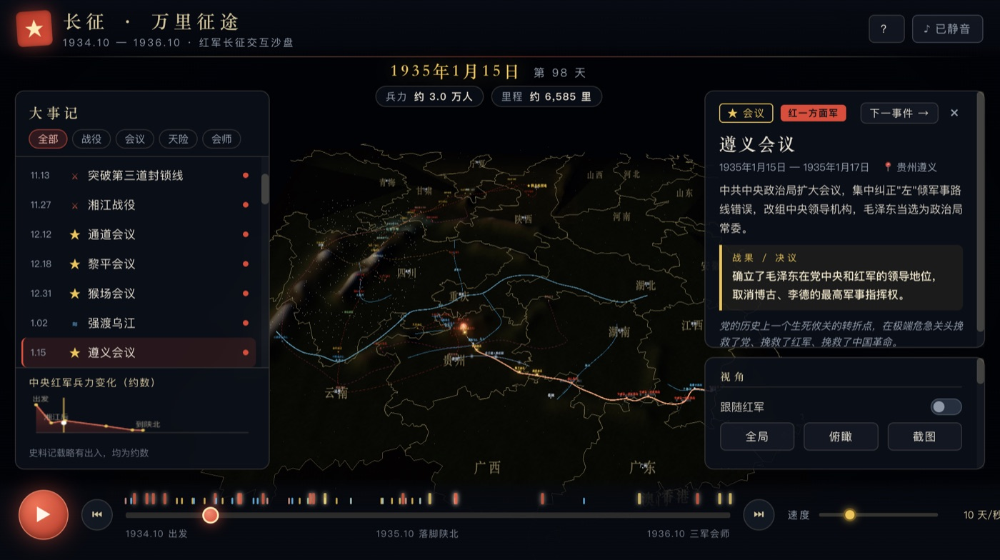
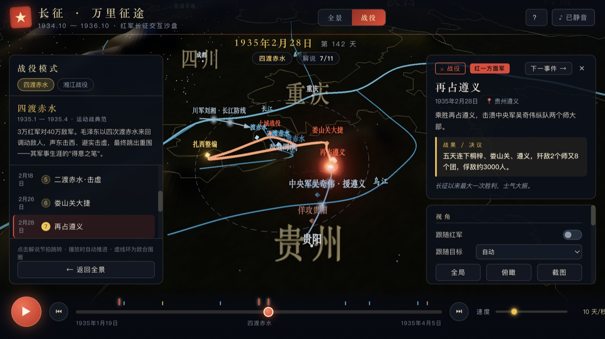
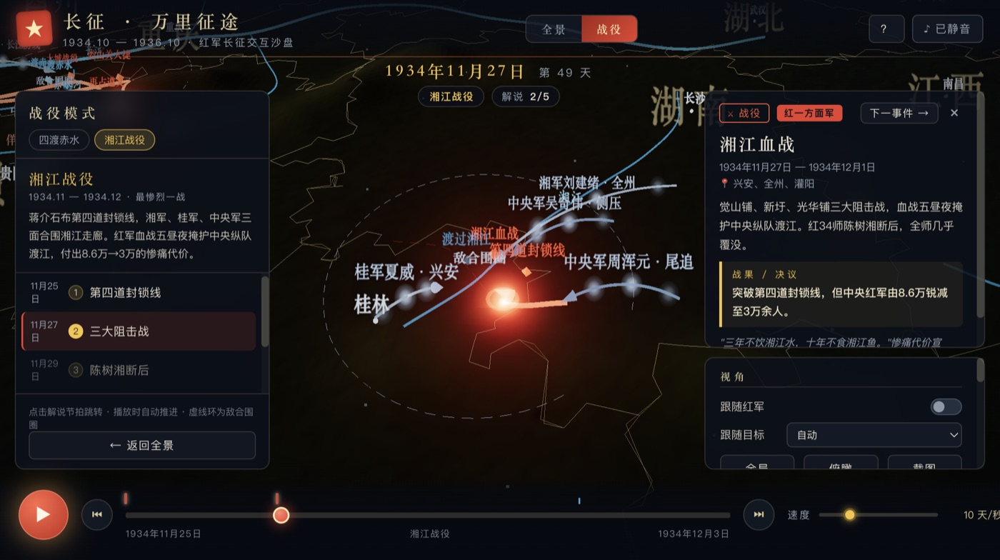

# 长征 · 万里征途 — 红军长征交互沙盘

> 基于 **Three.js + React + Vite** 的三维历史沙盘：按时间线推演红军三个方面军的长征轨迹与敌军围追堵截，内置**通用战役模式**逐场复盘经典战役（四渡赤水、湘江战役……），用"合围环 + 渐进箭头 + 解说节拍"再现敌人如何围、红军如何突。

**在线演示**：<https://lf7817.github.io/long-march/> （GitHub Pages，推送 `main` 自动构建部署）

<p align="center">
  
  
  
</p>

---

## 功能特性

### 全景模式（1934.10.10 — 1936.10.22）
- **时间线推演**：744 天全程播放 / 拖动 / 逐事件跳转；速度 1–40 天/秒可调。
- **三个方面军轨迹**：红一 / 红四 / 红二带日期路线按天生长，发光轨迹 + 行军军标 + 粒子尾迹；可单独开关。
- **敌军动态**：16 路追击 / 堵截 / 防堵箭头按时间窗显隐流动，四道封锁线、蒋介石督战驻地随史实迁移。
- **事件与战果**：50 个事件（战役 / 会议 / 渡河 / 雪山草地 / 会师 / 结盟），每到重大节点自动暂停并展开「战果 / 决议 / 意义」卡片。
- **实时 HUD**：日期 / 天数 / 中央红军兵力（约数）/ 红一方面军里程（二万五千里）/ 三军行军状态；兵力变化曲线。
- **大事记**：按类型筛选、点击跳转、当前高亮、未来事件置灰。

### 战役模式（通用、可扩展）
- 顶栏「全景 / 战役」一键切换；战役选择器切换不同战役。
- **区域相机**自动框选战役地理范围；**局部时间线**只在该战役日期区间播放。
- **只显相关图层**：该战役的红军机动路线、敌军各路箭头、事件标记；全景图层自动隐藏。
- **合围环**：随时间收缩的虚线包围圈，直观表现"敌人怎样围"；红军 zigzag 渐进轨迹表现"怎样突"。
- **解说节拍**：ordered 叙事步骤自动推进 + 点击跳转 + 当前高亮（复刻白板讲解的逐步叙事）。
- **收束总结**：播到终点弹出战役结论，提供「重播本战役 / 下一战役 / 返回全景」。
- **新增战役 = 加一条数据**：向 `src/battles.ts` 的 `BATTLES` 追加一个对象即可，无需改引擎或 UI（见下文）。

### 音景（肃穆、无打击乐）
- WebAudio 全合成：寒风 + 低音持续音铺底；战役 = 丧钟式深钟 + 远处闷雷，会议 = 暖垫，渡河 = 水声，雪山草地 = 风啸，会师 = 远处号角。
- 全部慢起慢落 + 生成式山谷混响；顶栏一键静音。

### 交互与控制
- **跟随红军** + **跟随目标**下拉（自动 / 红一 / 红四 / 红二；战役模式下为该战役红军路线）。
- 图层开关：敌军 / 红四 / 红二 / 地名 / 河流 / 全程轨迹预览。
- 效果滑杆：辉光强度 / 粒子密度 / 地形起伏 / 画面亮度；辉光开关、战役自动暂停开关。
- 视角：全局 / 俯瞰 / 跟随；**截图导出** PNG。
- 响应式：桌面 / 窄屏 / 手机三套布局。

---

## 快速开始

要求：**Node ≥ 20.19**、**pnpm ≥ 9**。

```bash
pnpm install     # 安装依赖
pnpm dev         # 开发服务器 → http://localhost:8173
pnpm build       # 类型检查 + 生产构建（dist/）
pnpm preview     # 预览生产构建
pnpm typecheck   # 仅类型检查
```

打开 http://localhost:8173 ，点击「开始征程」（带音景）或「静默浏览」。

---

## 操作说明

| 输入 | 作用 |
|------|------|
| 左键拖拽 / 滚轮 / 右键 | 旋转 / 缩放 / 平移 |
| 点击事件标记 / 时间轴刻度 / 大事记 / 解说节拍 | 跳转到对应节点 |
| `空格` | 播放 / 暂停 |
| `←` / `→` | ±5 天 |
| `↑` / `↓` | 上一 / 下一事件 |
| `F` | 跟随开关 |
| `M` | 静音 |
| `R` | 重置视角 |
| `H` | 帮助 / 图例 |

---

## 扩展一个新战役

战役完全由数据驱动。在 [`src/battles.ts`](src/battles.ts) 的 `BATTLES` 数组追加一个 `Battle` 对象：

```ts
{
  id: 'luding',
  name: '飞夺泸定桥',
  subtitle: '1935.5 · 大渡河天险',
  intro: '……开场概述……',
  conclusion: '……收束结论……',
  start: '1935-05-24', end: '1935-05-30',
  region: { lonMin: 101.8, lonMax: 103.2, latMin: 29.0, latMax: 30.2 }, // 相机框选范围
  red:   [{ id: 'main', label: '中央红军', color: 0xe8402f, glow: 0xff6a4d,
            points: [['1935-05-24', 102.35, 29.30], /* [日期, 经度, 纬度]… */] }],
  enemy: [{ id: 'e1', label: '川军·大渡河防线', force: '川军', kind: 'block',
            from: [102.9, 29.8], to: [102.3, 29.4], start: '1935-05-10', end: '1935-06-01' }],
  events:[{ id: 'ev1', date: '1935-05-29', lon: 102.23, lat: 29.91, name: '飞夺泸定桥',
            type: 'battle', place: '四川泸定', summary: '…', result: '…' }],
  steps: [{ date: '1935-05-29', title: '…', text: '…' }],   // 解说节拍
  ring:  { center: [102.3, 29.6], radiusStart: 1.2, radiusEnd: 0.4,
           start: '1935-05-24', end: '1935-05-29', label: '敌合围圈' }, // 可选
}
```

字段说明：`region` 决定相机；`red`/`enemy`/`events` 决定图层与卡片；`steps` 决定解说面板；`ring` 为可选合围环。引擎与 UI 自动适配，无需改动。

---

## 项目结构

```
├── index.html
├── vite.config.ts / tsconfig.json / package.json
├── public/data/provinces.json   # 简化省界（DataV GeoJSON 抽稀）
├── docs/screenshots/            # README 预览图
├── tools/build-geo.mjs          # 省界抽稀脚本（可复跑）
└── src/
    ├── main.tsx / App.tsx / styles.css
    ├── store.ts                 # zustand 状态桥（引擎 ↔ UI）
    ├── data.ts                  # 全景史料：路线/事件/敌军/山河/兵力（类型化）
    ├── battles.ts               # 战役模式通用 schema + 战役实例
    ├── engine/
    │   ├── Engine.ts            # 时间线/相机/粒子/拾取/模式切换/生命周期
    │   ├── world.ts             # 程序化地形/省界/河流/标注
    │   ├── armies.ts            # 轨迹/敌军/事件标记/合围环（贴地密集采样）
    │   └── audio.ts             # 肃穆合成音景
    └── components/              # TopBar/Hud/Chronicle/BattlePanel/EventCard/
                                 # ControlsPanel/Dock/Overlays/SceneCanvas
```

---

## 技术栈与取舍

- **Vite 8 + React 19 + TypeScript 5.9 + three 0.187 + zustand 5**。
- **不引入 react-three-fiber / drei**：本场景是单一时间线驱动的命令式模拟（轨迹 drawRange 渐进、粒子池、相机 tween、每帧批量更新），R3F 的声明式场景图收益小、反而增加版本链；故采用「plain three 引擎类 + React UI + zustand 状态桥」。pmndrs 生态仅取 zustand。
- **轨迹贴地**：沿路线密集采样地形高度重建曲线，避免插值切进山脊；管末端按弧长换算与军标精确对齐。
- **地理底图**：DataV 中国省界 GeoJSON 经 Douglas-Peucker 抽稀 + 程序化地形（山脉高斯脊 + 值噪声），雪山 / 草地 / 黄土高原分区着色。
- **音景**：WebAudio 全合成（无外部音频资源），生成式卷积混响。

---

## 数据与史实说明

- 事件坐标为**示意性近似值**；兵力数字为**史料约数**，各方记载略有出入。
- 史实依据公开党史、军史资料整理；诗词引用均署名（毛泽东《七律·长征》等）。
- 本项目仅供**学习与交流**，不作商业或权威史学用途。

---

## 许可

仅供学习交流使用。引用史料与诗词版权归原作者所有。